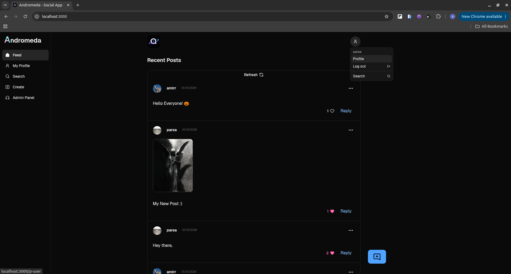
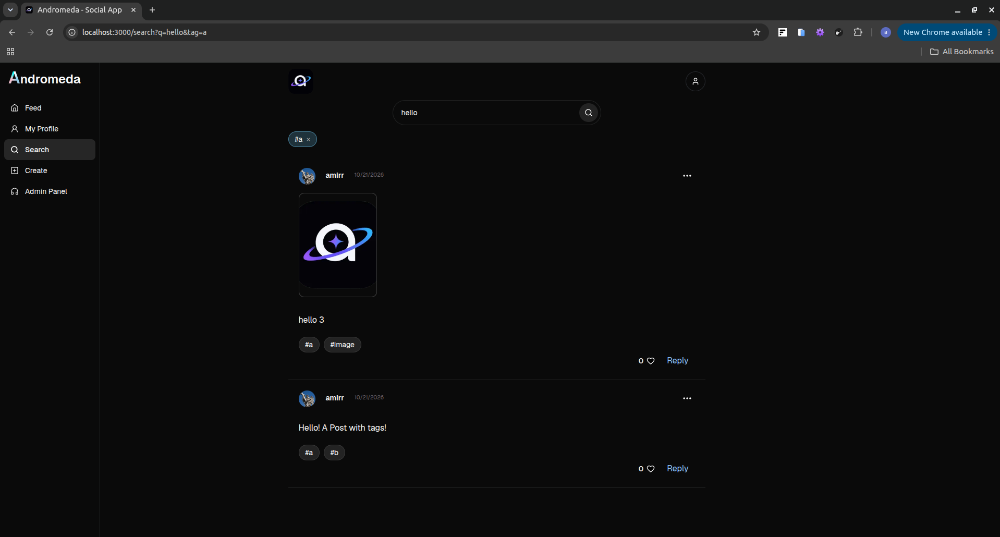
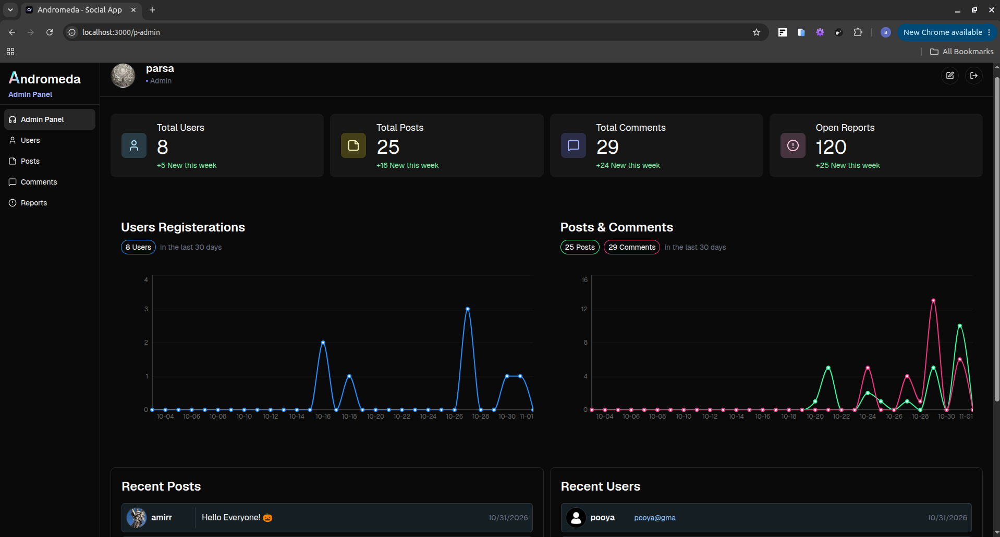
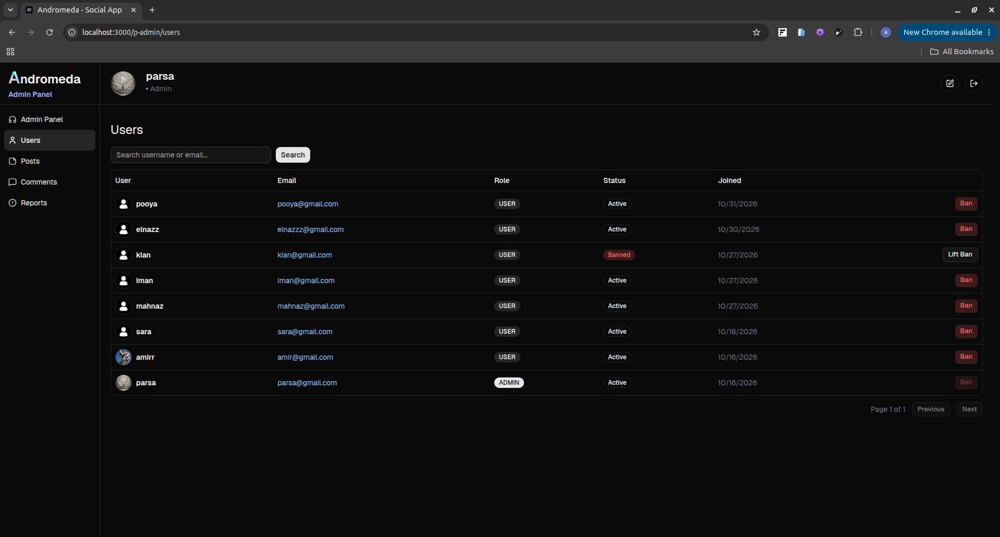
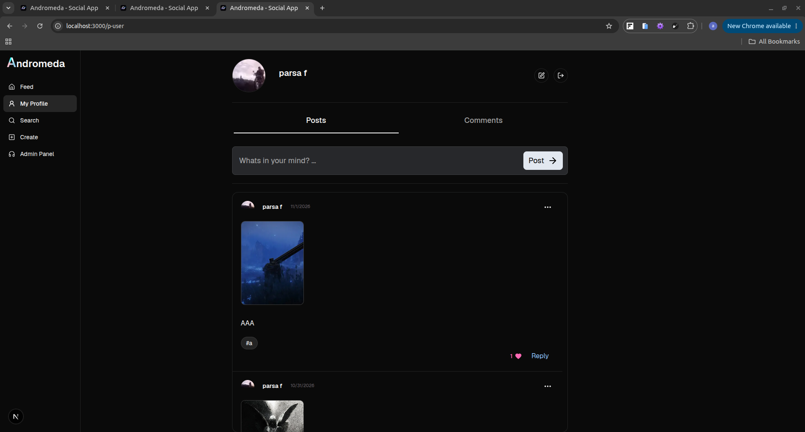
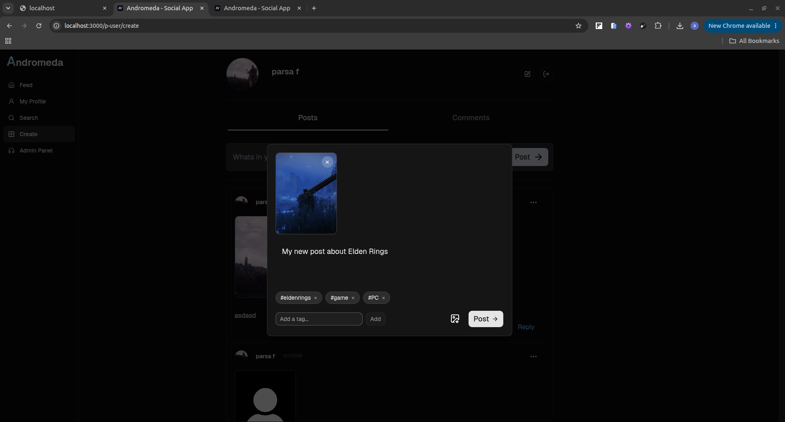
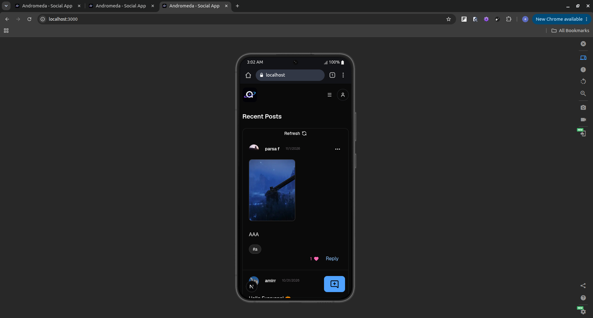
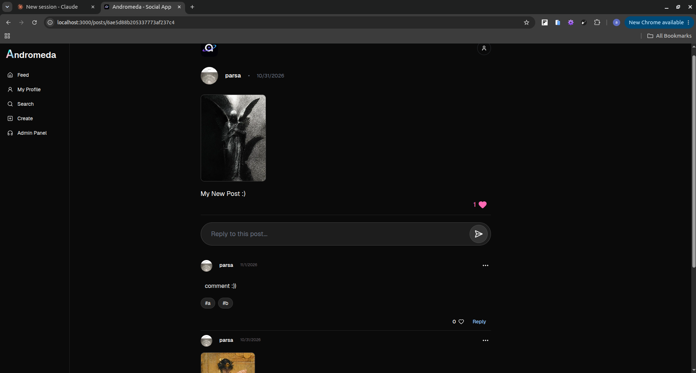

<div align="center">

# Andromeda

**A full-stack social media app built with Next.js (App Router), TypeScript and MongoDB.**

Posts, comments with nested replies, likes, tag search, infinite scroll, and a complete admin panel with analytics and moderation tools.


</div>

> **Live demo:** [Andromeda Social App](https://andromeda-social-app-vercel-tau.vercel.app/) &nbsp;|&nbsp; **Screenshots:** see [below](#-screenshots)

---

## Table of Contents

- [Overview](#-overview)
- [Screenshots](#-screenshots)
- [Features](#-features)
- [Tech Stack](#-tech-stack)
- [Architecture Highlights](#-architecture-highlights)
- [Pages and Routes](#-pages-and-routes)
- [Getting Started](#-getting-started)
- [Environment Variables](#-environment-variables)
- [Testing](#-testing)
- [Project Structure](#-project-structure)
- [Challenges and Solutions](#-challenges-and-solutions)
- [Known Limitations](#-known-limitations)
- [Roadmap](#-roadmap)

---

## Overview

Andromeda is a social platform where users publish posts (with an optional image and tags), reply to posts and to other comments in nested threads, like content, and search by title and `#tags`. Admins get a dedicated panel with stats, charts and moderation tools (ban users, delete posts and comments).

The project was built to go beyond a CRUD demo. It focuses on the problems real apps run into: **session handling with refresh tokens, streaming UI with Suspense, cursor-based pagination, data integrity on cascading deletes, secure uploads, and responsive layouts**. Each of these is documented in the [Challenges and Solutions](#-challenges-and-solutions) section.

---

## Screenshots


| Feed | Search with tag chips |
|---|---|
|  |  |

| Admin dashboard | Admin users table |
|---|---|
|  |  |

| User Profile | Create Post |
|---|---|
|  |  |

| Mobile UI | Post with nested replies |
|---|---|
|  |  |

---

## Features

### Users
- Sign up, sign in and sign out with **access + refresh token** authentication (HTTP-only cookies)
- Automatic, silent token refresh (users are never logged out because a 15-minute token expired)
- Return to the originally requested page after signing in (open-redirect safe)
- Edit profile (username, email, avatar) with live avatar preview
- Login/Register shown as **modals** on the home page (intercepting routes) and as full pages on direct navigation

### Content
- Create posts with text, an optional image and up to 5 tags
- Comment on posts and **reply to comments in nested threads**, with lazy-loaded replies
- **Like and unlike** posts and comments with optimistic UI updates
- Delete your own posts (comments, likes and image files are cleaned up)
- Zoomable image viewer that keeps the aspect ratio on any screen size

### Discovery
- Home feed with **infinite scroll** (cursor-based) and manual refresh
- Search by title words and `#tags`, combined; the URL is the source of truth, so searches are shareable
- Tag chips that can be removed individually

### Admin Panel
- Dashboard with totals, "new this week" counts and 30-day charts (registrations, posts and comments)
- Recent users and recent posts lists
- Users table: search, pagination, **ban / lift ban** with reasons and history
- Posts and comments tables: search, pagination, delete with full cascade
- All actions are authorized on the server, never only by hiding buttons

### Experience
- Fully responsive: off-canvas sidebar on mobile, icon rail on tablets, full sidebar on desktop
- Streaming with Suspense and same-size skeletons, so the page shell appears instantly
- Toast feedback, disabled and pending states, and error recovery (Retry buttons)

---

## Tech Stack

| Area | Technology |
|---|---|
| Framework | [Next.js](https://nextjs.org/) (App Router, Server Components, Server Actions, Route Handlers, `proxy.ts`, parallel and intercepting routes) |
| UI library | [React](https://react.dev/) |
| Language | TypeScript |
| Database | MongoDB with [Mongoose](https://mongoosejs.com/) |
| Styling | [Tailwind CSS](https://tailwindcss.com/) and [shadcn/ui](https://ui.shadcn.com/) |
| Forms and validation | React Hook Form and [Zod](https://zod.dev/) (client and server schemas) |
| Auth | `jsonwebtoken` (access and refresh tokens), `bcryptjs` (password hashing) |
| Data display | TanStack Table, Recharts (via shadcn charts) |
| Infinite scroll | `react-intersection-observer` |
| Icons | lucide-react |
| Testing | [Vitest](https://vitest.dev/) |

---

## Architecture Highlights

- **Server-first rendering.** Pages are Server Components that stream data in independent `<Suspense>` sections. Client Components are used only where interaction is needed.
- **Authentication in `proxy.ts`.** The proxy refreshes expired access tokens before rendering, writes the new token to both the request and the response, and redirects only protected routes. Server Components stay read-only (`authUser()` / `authAdmin()` wrapped with `React.cache`).
- **Identity always comes from the session.** Server Actions and route handlers never trust a user id sent by the client. Ownership is enforced inside database queries.
- **Cursor-based pagination.** One shared query helper serves the first server render and the paginated API routes, so both return the same shape.
- **Denormalized counters with integrity rules.** `likesCount` and `isBanned` are cached on documents for fast reads, with history in separate collections (`Like`, `Ban`) and updates applied only when a record is actually created or removed.
- **Route groups.** `(site)` holds the app and the modal slot, `(auth)` holds the standalone sign-in/sign-up pages with their own root layout.

---

## Pages and Routes

| Route | Description | Access |
|---|---|---|
| `/` | Home feed with infinite scroll | Public |
| `/search?q=&tag=` | Search by words and tags | Public |
| `/posts/[id]` | Post page with nested comments | Public |
| `/signin`, `/signup` | Authentication (modal or full page) | Guests only |
| `/p-user` | Profile, posts and comments tabs | Authenticated |
| `/p-user/create` | Create a post | Authenticated |
| `/p-admin` | Dashboard: stats, charts, recent activity | Admin |
| `/p-admin/users` | Manage users, ban / lift ban | Admin |
| `/p-admin/posts` | Manage posts | Admin |
| `/p-admin/comments` | Manage comments | Admin |

<details>
<summary><strong>API overview</strong></summary>

| Endpoint | Purpose |
|---|---|
| `POST /api/auth/signup`, `POST /api/auth/signin` | Register and sign in, set cookies |
| `POST /api/auth/refresh` | Issue a new access token from a valid refresh token |
| `PUT /api/users/[id]` | Update profile (own account only) |
| `DELETE /api/posts/[id]` | Delete own post with cascade |
| `GET /api/posts/paginated`, `GET /api/posts/paginated/search` | Cursor-paginated feed and search |
| `GET /api/posts/[id]/comments`, `GET /api/comments/[id]/replies` | Paginated comments and replies |
| `POST` / `DELETE /api/likes` | Like and unlike |
| `DELETE /api/admin/posts/[id]`, `DELETE /api/admin/comments/[id]` | Admin deletion with cascade |
| `POST /api/admin/users/[id]/ban`, `POST /api/admin/users/[id]/lift-ban` | Ban management |

</details>

---

## Getting Started

### Prerequisites

- Node.js 20 or newer
- A MongoDB database (local, or a free [MongoDB Atlas](https://www.mongodb.com/atlas) cluster)

### Installation

```bash
# 1. Clone the repository
git clone https://github.com/<your-username>/andromeda-social-app.git
cd andromeda-social-app

# 2. Install dependencies
npm install

# 3. Create your environment file
cp .env.example .env.local
# then fill in the values (see below)

# 4. Start the dev server
npm run dev
```

Open [http://localhost:3000](http://localhost:3000).

> The **first user to sign up automatically becomes an admin**, so you can explore the admin panel right away.

### Scripts

| Script | Description |
|---|---|
| `npm run dev` | Start the development server |
| `npm run build` | Production build |
| `npm start` | Run the production build |
| `npm test` | Run unit tests once (Vitest) |

### Testing on your phone (same Wi-Fi)

Next.js blocks dev resources from unknown origins. Add your machine's local IP to `next.config.ts`:

```ts
const nextConfig = {
  allowedDevOrigins: ["192.168.x.x"],
};
```

---

## Environment Variables

Create `.env.local` (never commit it):

```env
# MongoDB connection string
MONGODB_URL=mongodb://127.0.0.1:27017/andromeda

# Use long, random, different values for each secret
ACCESS_TOKEN_SECRET_KEY=change-me-access
REFRESH_TOKEN_SECRET_KEY=change-me-refresh
```

> Match the variable names with the ones your `configs/db.ts` and `utils/auth.ts` read. Generate strong secrets with `openssl rand -base64 48`.

---

## Testing

Security-sensitive pure utilities are covered with unit tests:

- JWT verification: valid, expired, tampered and garbage tokens
- Upload sniffing: real PNG/JPEG detection, HTML/SVG disguised as images rejected
- Search normalization: `q=a b` and `q=a&q=b` behave the same, tags are lowercased and de-duplicated, limits enforced
- Regex escaping: user input is matched literally

```bash
npm test
```

---

## Project Structure

```text
app/
├── (site)/                 # Main app: layout with sidebar and @modal slot
│   ├── @modal/             # Intercepting routes for sign-in / sign-up modals
│   ├── p-user/             # User profile and create post     
│   ├── posts/[id]/         # Post page
│   ├── search/             # Search (layout keeps the bar, page streams results)
│   └── page.tsx            # Feed
├── (admin)/                 
│   └── p-admin/            # Admin panel (dashboard, users, posts, comments)
├── (auth)/                 # Standalone sign-in / sign-up pages (own root layout)
└── api/                    # Route handlers (auth, posts, comments, likes, admin)
uploads/                    # Runtime image uploads (git-ignored), served by /api/files
actions/                    # Server Actions (create post, create comment)
components/
├── modules/                # Reusable pieces (Header, Sidebar, PostCard, MediaModal...)
├── templates/              # Page-specific sections
└── ui/                     # shadcn/ui primitives
configs/                    # Database connection
models/                     # Mongoose models (User, Post, Comment, Like, Ban)
utils/                      # Auth, validation, pagination, upload and search helpers
proxy.ts                    # Session refresh and route protection
```

---

## Challenges and Solutions

A selection of real problems met while building the project and how each was solved.

| Problem | Solution |
|---|---|
| **Authentication with Refresh Tokens** — The access-token cookie expires after 15 minutes and the browser deletes it, while the refresh token is still valid. Users were treated as logged out on public pages, and actions like commenting failed. | Moved token refresh into `proxy.ts` (middleware) and applied it to all pages, not only protected ones. When the access token is missing or expired, the proxy silently calls a `POST /api/auth/refresh` endpoint, which validates the refresh token against the database and returns a new access token as JSON. The new token is written to both the incoming request cookies (so Server Components and Server Actions in the same request see it) and the response cookies (so the browser stores it). Only protected routes redirect to `/signin`. Server Components cannot write cookies, so `authUser()` stays read-only and the proxy keeps the session fresh. Banned users (`isBanned: true`) are refused new tokens. |
| **Login/Register Modals on the Home Page Without Showing Them on Auth Pages** — A root-level `@modal` slot intercepted every soft navigation to `/signin` and `/signup`, including links inside the auth pages themselves, so modals opened on top of the full pages. | Used **Parallel Routes** with **Intercepting Routes** for the modals, but scoped the `@modal` slot to a `(site)` route group, with the standalone auth pages in a separate `(auth)` group. Links between the two standalone forms use hard navigation (`<a>`, with the ESLint rule disabled on that line), because interception only applies to client-side navigation. Direct navigation and refreshes still render the dedicated pages. |
| **Avoiding Duplicate Database Requests in Server Components** — Both `app/p-user/layout.tsx` and `app/p-user/page.tsx` need the authenticated user's data from `authUser()`, which could result in redundant database requests during the same render. | Wrapped `authUser()` and `authAdmin()` with **`React.cache()`** in `serverHelpers.ts`. This memoizes function results within the same server render/request context, allowing multiple Server Components to reuse the result instead of repeating the same database lookup. |
| **Profile Editing with Optional Avatar Uploads** — Updating a user's username and email while allowing them to optionally upload a new avatar without requiring an image on every update. | Implemented a `PUT` API endpoint using `FormData` and separate Zod schemas for client-side and API validation. The client schema validates the avatar as a `FileList`, while the API schema validates it as a `File`. The API converts a missing avatar (`null` from `FormData.get()`) to `undefined`, validates the submitted data, and updates the avatar only when a new image is provided, preserving the existing avatar otherwise. |
| **Live Avatar Preview Before Saving** — Letting users preview a newly selected avatar before submitting their profile changes. | Used `URL.createObjectURL()` to generate a temporary preview URL for the selected image and displayed it in the form. The preview is cleared when the user discards their changes, so the existing avatar remains unchanged unless the form is successfully submitted. |
| **Refreshing Server-Rendered Profile Data After an API Update** — Calling `revalidatePath()` in a Route Handler does not necessarily update the currently displayed client UI immediately. | Used `revalidatePath('/p-user')` in the API endpoint to invalidate the relevant route cache and `router.refresh()` in the client component after a successful update. This triggers a new Server Component render without requiring a full browser reload. |
| **Restricting Profile Updates to the Authenticated User** — Preventing users from modifying another user's profile by changing the user ID in the API URL. | Used `authUser()` on the server to identify the authenticated user and compared their ID with the ID in the request URL. Requests targeting another user's profile are rejected with `401 Unauthorized`. |
| **Scrollable Posts Section Within a Fixed-Height Profile Layout** — Allowing the posts list to scroll independently while keeping the profile header and other layout sections in place. | Used a constrained viewport-height layout with Tailwind CSS utilities such as `h-svh`, `flex-col`, `grow`, `min-h-0`, and `overflow-y-auto`. Applied the scrolling behavior to the posts container rather than the entire page, allowing the header and other sections to remain fixed while the posts list scrolls. |
| **Controlled Tabs for Switching Between Profile Content** — Keeping track of the selected tab and rendering the corresponding content when users switch between posts and comments. | Used the controlled state pattern with `useState()` and the shadcn/ui `Tabs` component. The selected tab is managed through the `value` and `onValueChange` props, allowing the displayed content to stay synchronized with the active tab. |
| **Server-Side Validation for Post Creation** — Ensuring that post data remains valid even when client-side validation is bypassed. | Implemented server-side validation with Zod and a dedicated Server Action schema. Handled serialized form data and optional image uploads while validating all submitted fields before database persistence. |
| **Handling File Uploads and Image Persistence** — Validating uploaded images and storing their references alongside post data. | Implemented image validation and filesystem-based storage for uploaded files (in a private `uploads/` folder served by a route handler, see the 404 row below), and integrated the resulting image URLs into post documents. For production, uploads must move to object storage (e.g. Vercel Blob or S3), since serverless file systems are read-only and request bodies are size-capped. |
| **Fetching Related Data with Nested Population** — Retrieving post authors, comments, and comment authors without manually querying each relationship separately. | Used Mongoose's `populate()` and nested population capabilities to resolve related documents and retrieve only the user fields required by the interface. |
| **Protecting Sign-in/Sign-up Pages From Logged-in Users** — A logged-in user whose access-token cookie was deleted manually could still open `/signin` and `/signup`. | Added an `authUser()` check in the `(auth)` layout that redirects authenticated users. Because the proxy refreshes the access token before rendering, a user who only has a valid refresh token is also recognized and redirected. This is a UX guard, not a security boundary, so it lives in the pages and the proxy stays focused on session refresh and protected routes. |
| **Paginating Comments Without Skipped or Duplicated Items** — Loading all comments of a post is not performant, and `skip`-based pagination breaks when new comments arrive between requests. | Implemented **cursor-based pagination** using the last `_id` (`_id: { $lt: cursor }`, sorted by `_id` descending). The query fetches `limit + 1` documents to know whether a next page exists, so the "load more" trigger only appears when there is more data. A shared query helper serves both the initial server render and the `GET /api/posts/[id]/comments` endpoint, and the client de-duplicates incoming comments by `_id`. |
| **Infinite Scroll That Stalls or Spams Requests** — With an `IntersectionObserver` sentinel (`useInView`), the next page never loaded if the sentinel stayed visible after a fetch, and a failed request could trigger an endless retry loop. | The effect depends on `inView`, `cursor` and `isLoading`, so it re-checks after every completed fetch and keeps loading until the sentinel leaves the viewport. A `hasError` flag stops automatic loading after a failure and shows a manual "Retry" button instead. A `rootMargin` starts loading slightly before the user reaches the end of the list. |
| **Stale Client State After Server Revalidation** — `useState(initialComments)` ignores new props, so a newly posted comment did not appear after `revalidatePath`. | Gave the client list component a `key` derived from the first comment's id, so it remounts with fresh server data when the latest comment changes. |
| **Reusing One Pagination Logic Across Features** — Comments and the home feed both needed cursor-based infinite scroll, which risked duplicated query and client-state code. | Extracted the cursor query (`_id: { $lt: cursor }`, `limit + 1`, `nextCursor`) into shared helpers (`getPosts`, `getPostComments`) used by both the Server Component's first render and the paginated API routes, so the first page is server-rendered and later pages are fetched on scroll with the same logic and response shape. |
| **Slow Search Results Blocking the Whole Page** — The search page is dynamic, so the search bar and header only appeared after the database query finished, and users could not edit their query while waiting. | Moved the header and search bar into a shared `layout.tsx` and kept only the results in `page.tsx`, wrapped in `<Suspense key={query} fallback={<ResultsSkeleton />}>`. The layout is preserved across navigations, so the input stays usable while results stream in, and the skeleton is shown again for every new query. The search bar sits in its own Suspense boundary, separate from the results, so it never disappears while results load. |
| **Client State Not Syncing With the URL After Moving a Component Into a Layout** — Tags typed into the search input updated the URL, but the chips did not appear, because `useState(initialValue)` ignores later changes and layouts do not remount on navigation. | Wrapped the search bar in a small client component that reads `useSearchParams()` and renders `<SearchBar key={searchParams.toString()} />`, so the bar remounts and rebuilds its state from the URL on every query change. This replaced a `useEffect` that re-set state on every render (a new array reference each time). |
| **Slow Data Blocking First Paint** — Pages awaited the user and database queries before sending anything, so users saw a blank screen even though most of the layout needed no data. | Restructured pages for granular streaming: layouts render synchronously, user-dependent parts (header, sidebar) live in async Server Components inside their own `<Suspense>` with same-size skeletons, and data-heavy sections (feed, search results) stream independently. `React.cache` de-duplicates `authUser()` across these boundaries within one request. |
| **Returning Users to Their Original Page After Sign-in** — Users redirected to `/signin` from a protected page ended up on a default page after logging in, and intercepting-route modals made `router` navigation unreliable. | The proxy passes the originally requested URL as `return_url`; the sign-in/sign-up forms redirect there after success using a full `window.location.replace` (a reload is acceptable after login and refreshes all server-rendered, user-dependent UI). The value is validated by a shared helper that only accepts same-origin paths (rejecting absolute URLs, `//` and `/\`) to prevent open-redirect attacks, and is URL-encoded when carried between the sign-in and sign-up forms. |
| **Letting Users Delete Only Their Own Posts** — Deleting by ID alone would let any logged-in user delete other users' posts, and deleting just the post would leave orphaned comments and image files. | The `DELETE` route identifies the user from the session (never from client input) and puts ownership in the query itself (`findOneAndDelete({ _id, user })`), so the check and delete are one atomic operation and the response doesn't reveal whether someone else's post exists. After a successful delete, related comments and the stored image file are cleaned up. |
| **Safely Handling Arbitrary Search Query Params** — `q` and `tag` can arrive as missing, single or repeated values, and unsanitized input could become a regex or a huge query. | Normalized params in one shared function (string/array handling, trimming, lowercase, de-duplication, max word/tag count and length). Words are matched with an AND of escaped, case-insensitive regexes (`escapeRegex` prevents regex injection), and tags with `$all`. An empty query returns no results instead of the whole collection. |
| **Shareable, Refresh-Safe Search State** — Search terms and `#tags` needed to survive reloads, back/forward navigation and link sharing, while paginated results had to stay in sync with the query. | Made the URL the single source of truth (`?q=a&q=b&tag=x`): the search bar parses `#tag` tokens into `tag` params and shows them as removable chips, the Server Component runs the first query from `searchParams`, and the infinite-scroll client forwards the same params plus a cursor to a paginated API. The results list is keyed by the normalized query so its state resets whenever the query changes. |
| **Admin Dashboard Stats Without Loading Whole Collections** — Counting users, posts and comments by fetching every document (including password hashes) was slow and exposed sensitive fields to the render layer. | Used `estimatedDocumentCount()` for totals and `countDocuments()` filtered by an ObjectId-derived timestamp for "new this week", run in parallel with `Promise.all`. Recent-activity lists fetch only a few documents with `lean()` and projected fields, each inside its own `<Suspense>` boundary with a skeleton. |
| **Daily Charts Without a `createdAt` Field** — Old documents had no timestamp, and charting sparse data leaves gaps in the time axis. | Derived the date from the ObjectId inside the aggregation (`$toDate: "$_id"`, grouped with `$dateToString` in the local timezone and filtered by `_id` so the default index is used), then filled days with no activity with zeros on the server. The date key is produced with an `Intl.DateTimeFormat` using the same timezone and format so both sides match. The chart is a client component (shadcn/recharts) fed plain serializable data, with integer-only Y ticks. |
| **Banning Users Reliably** — Setting a flag alone would leave a banned user active until their access token expired (15 min) and would lose who banned whom and why. | Kept a fast `isBanned` flag on `User` (checked by `authUser`, sign-in and refresh) plus a `Ban` collection as history/audit (admin, reason, lifted-at). The ban endpoint is admin-only, refuses to ban admins or already-banned users, clears the stored refresh token so sessions can't be renewed, and compensates by deleting the `Ban` record if the user update fails. Lifting a ban targets the *active* ban (`liftedAt` unset) and rolls back if the flag update fails. |
| **Admin User and Post Tables With Safe Moderation Actions** — Listing every document client-side would expose sensitive fields and scale badly, and moderation actions need confirmation and instant feedback. | A Server Component runs a projected, paginated and searchable query (URL as the source of truth) and passes plain rows to a shadcn/TanStack table with server-side pagination. Ban, lift-ban and delete use a confirmation dialog, call admin-only endpoints (`authAdmin()` checked server-side, never only by hiding buttons), then `router.refresh()` re-renders the table. `password` and `refreshToken` are never selected. |
| **Cascading Deletes Across a Comment Tree** — Deleting a post or comment left orphaned replies, stale `comments`/`hasReply` references and image files on disk, and a first version removed deep replies while keeping top-level comments. | Post deletion removes all comments by `post` in one query; comment deletion collects the reply subtree generation by generation (each round replaces the parent set, so the loop terminates). Both then clean up references in the post and parent comment (`$pull`, resetting `hasReply` when empty) and delete image files last through a helper that resolves the final path and checks it stays inside the allowed folder (preventing path traversal). The same logic serves the author and admin endpoints. |
| **Identity Spoofing Through Client-Supplied User IDs** — Server Actions took the author's `user` id from form data, so anyone could post as another user (or while logged out) by editing the request. | Removed `user` from forms and schemas; every action and route handler resolves the user from the verified session (`authUser()`), rejects unauthenticated requests, and enforces ownership inside the database query. |
| **Trusting Client-Declared File Types** — Upload validation relied on `file.type` and the original file name, both controlled by the client, so a non-image (or an SVG/HTML payload) could be stored in `public/` and served back. | Uploads are validated server-side by checking magic bytes against an allow-list (PNG, JPEG, GIF, WebP), the extension is derived from the detected type, and file names are fully generated (`timestamp-uuid.ext`), so user input never reaches the file-system path. Size limits are enforced in the schemas and at the request-body level (`serverActions.bodySizeLimit`, since Next's 1 MB default rejects the request before validation runs). |
| **Uploaded Images Returning 404 in Production Builds** — Avatars and post images uploaded at runtime worked with `npm run dev` but failed with `internal image response failed ... 404` after `npm run build && npm start`, even though the upload succeeded and the file existed on disk. | In a production build the contents of `public/` are fixed at build time, so files written there while the app is running are not served. Uploads moved from `public/images/...` to a private `uploads/` folder (git-ignored), and are served through a `GET /api/files/[...path]` route handler that only allows image extensions, resolves the final path and rejects anything outside `uploads/` (path traversal), and sends long-lived `immutable` cache headers (safe because file names are random). The database stores `/api/files/...` URLs, which `next/image` can optimize like any local path. |
| **Duplicate Accounts Under Concurrent Sign-ups** — A `findOne` check before `create` can't stop two simultaneous requests from registering the same email or username, and a compound unique index only made the *pair* unique. | Added separate unique indexes for `email` (stored lowercase and trimmed) and `username`, and map duplicate-key errors (`11000`, via a shared `isDuplicateKeyError` guard) to `409`, so the database enforces uniqueness while the pre-check only improves the message. |
| **Mongoose `ValidationError` Affecting Only Some Users on Login** — Some users got a 500 on sign-in with `ValidationError: avatar: false`, while others logged in fine. | The schema had `required: 'false'` (a truthy string) instead of the boolean `false`, making `avatar` mandatory. Older users without an avatar failed when `user.save()` re-validated the whole document to store the new refresh token. Fixed the schema and switched to `updateOne({ $set: { refreshToken } })`, which does not depend on validation of unrelated fields. |
| **Likes With Consistent Counts and Instant Feedback** — Likes needed to feel instant, stay correct under double clicks, and show the right state on every page. | Likes are documents with a unique `{ user, post }` index plus a cached `likesCount`, incremented only when a record was actually created or deleted. Each page of posts gets `isLiked` from one batched query (no N+1 requests), and the card updates optimistically, treats 409 as "already in that state" and rolls back on failure. |
| **Orphaned Likes After Deleting Content** — Likes reference posts and comments, so deleting content left like records pointing at nothing (and a nested array in `$in` crashed the cleanup). | Delete endpoints collect the ids of the post/comment and its whole reply subtree, then remove comments and their likes with one flat `$in` query each, before deleting image files as the final, irreversible step. |
| **Sessions Breaking After Changing Email** — Tokens carried the user's email, so after editing the profile email the old tokens matched no user and the person appeared logged out. | Short term: new tokens are issued right after the email change. Planned fix: put the immutable user `_id` in the token and resolve users with `findById`, so mutable fields can change without invalidating sessions. |
| **Comment Form Opening the File Picker of a Different Form** — Choosing an image in a reply form showed the preview in the top-level comment form. | Several `CommentForm` instances shared the same input `id`, so each `<label htmlFor>` resolved to the first input in the document. Unique ids per instance via `useId()` fixed it (a `key` could not, since the issue was DOM id resolution, not React reconciliation). |
| **New Replies Not Appearing Until a Page Reload** — Posting a reply refreshed the top-level list but left the parent's `hasReply` flag and its loaded replies stale, so the "Show Replies" button and the new reply only appeared after reloading. | The comment card keeps `hasReply` in local state, and after a successful reply it sets the flag, opens the thread and re-fetches its replies, so the new reply appears immediately without a full page refresh. |
| **Resetting a Form Hosted in a Modal** — The form stayed mounted while the modal was closed, so text, tags and previews survived reopening. | Render the form only while the modal is open so React discards all local state automatically instead of syncing it with effects; preview object URLs are revoked when removed. |
| **Server Action Results Not Showing Toasts** — With `useActionState` + `useEffect`, state resets and re-renders made success toasts unreliable. | Call the action directly inside `startTransition`, await its result, and show toasts and reset the form in the same handler, using the transition's pending flag for disabled states. |
| **Stale Like Counts After "Refresh"** — Refreshing the feed replaced the posts but cards kept their old `useState` like counts. | Card state is initialized from props, which React ignores after mount, so the list key includes the data that must reset (`id`, `likesCount`, `isLiked`). |
| **Zoomable Media Without Overflowing the Screen** — Fixed-size containers cropped or overflowed very wide/tall images. | One shared `MediaModal`: natural aspect ratio with `max-w`/`max-h` viewport caps and `object-contain`, instead of fixed width/height. |
| **Admin Tables: Navigation Feedback Without Skeleton Flashes** — Skeletons on every query change made tables flash; with none, the UI looked frozen. | Suspense skeleton for the first load only; pagination and search wrapped in `useTransition`, dimming the current table and disabling controls while `isPending`. One shared hook serves all admin tables. |
| **One Sidebar for Mobile, Tablet and Desktop** — A fixed sidebar covered content on medium screens and mobile needed a different pattern. | A single shadcn sidebar: off-canvas drawer below `md` (header trigger, closes on navigation), icon rail between `md` and `xl` via a `matchMedia`-controlled provider, full on large screens. The provider remounts only once to fix the post-reload initial state, so animations are preserved. |
| **Consistent Loading Experience Across Routes** — Post and profile pages blocked on several queries. | Route-level `loading.tsx` plus independent `<Suspense>` sections with same-size fallbacks, so the page shell appears immediately and each section streams in independently. |
| **Testing Pure Utilities** — Security-sensitive helpers (token verification, upload sniffing, search normalization, regex escaping) should not regress silently. | Unit tests with Vitest for these pure functions (valid/expired/tampered tokens, disguised HTML/SVG uploads, `q=a b` vs `q=a&q=b`, literal regex matching). Run with `npm test`. |

---

## Known Limitations

Being upfront about the current trade-offs:

- **Uploads are stored on the local file system** (`uploads/`, served through `/api/files/...`; they were moved out of `public/` because files added at runtime are not served from `public/` in production builds). This works locally and on a traditional server with a persistent disk, but not on serverless platforms such as Vercel. Moving to object storage (Vercel Blob, S3, Cloudinary) is the next step for deployment.
- **Tokens carry the user's email**, so changing the email requires re-issuing tokens. Moving to the immutable user `_id` is planned.
- **No refresh-token rotation or rate limiting** on sign-in yet.
- **One image per post.** Multi-image and video support are on the roadmap.
- Test coverage focuses on pure utilities; there are no end-to-end tests yet.

---

## Roadmap

- [ ] `/p-user/likes` page (liked posts)
- [ ] Infinite loading for the posts and comments tabs in the profile
- [ ] Report system with an admin review queue
- [ ] Tracking system for statistics, so charts survive deleted content
- [ ] Post views tracking
- [ ] Multi-image posts and video/GIF support
- [ ] Saving, quoting and reposting posts
- [ ] Ticket and support system
- [ ] Real-time direct messaging (WebSockets)
- [ ] Refresh-token rotation and rate limiting
- [ ] Object storage for uploads and a live deployment
- [ ] PWA support

---

## Author

**Parsa Farahani** — [GitHub](https://github.com/parsa-farahani) · [LinkedIn](http://www.linkedin.com/in/parsa-farahani-935195293) · [aiparsa83@gmail.com](mailto:aiparsa83@gmail.com)

If you like this project, a star is appreciated.

---

<div align="center">
Built with Next.js, TypeScript and MongoDB
</div>